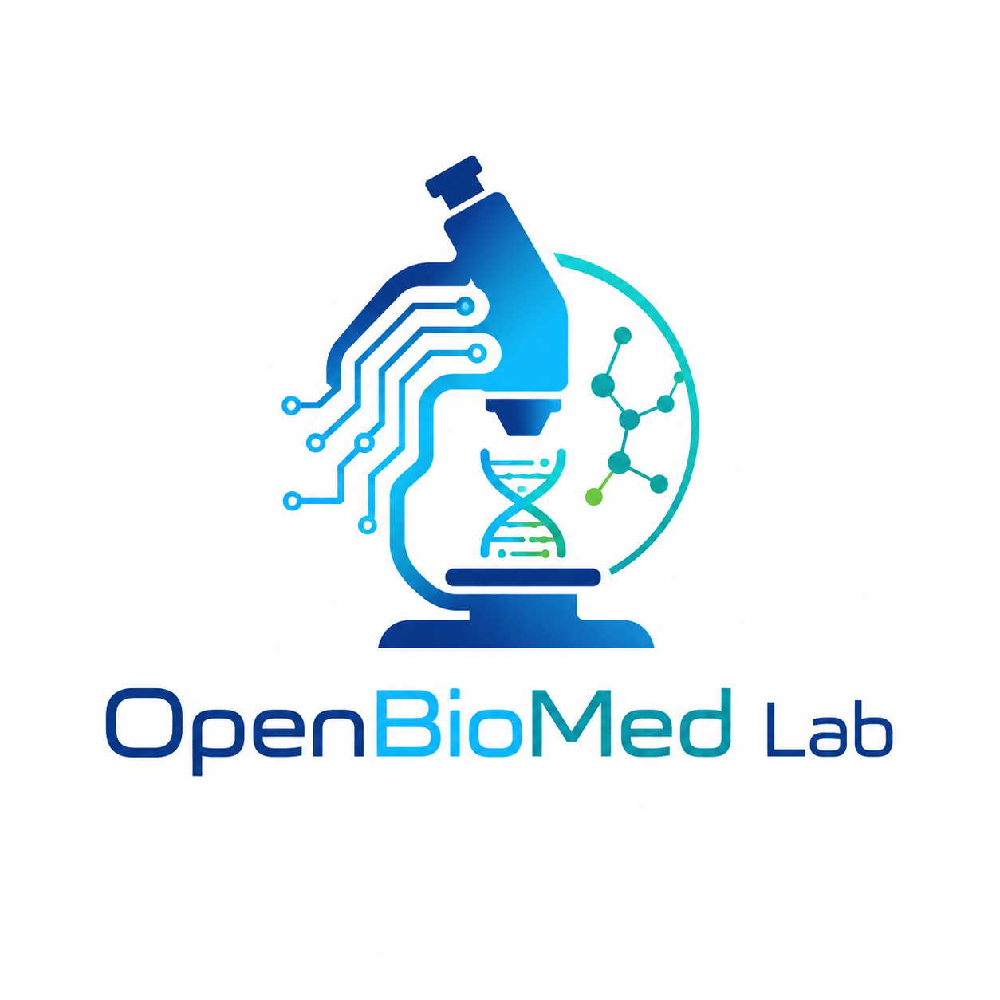

<p align="center">
  
</p>

# OpenBioMed Lab

[](literature-learning-suite/LICENSE)

OpenBioMed Lab 收集生物医学 AI 研究中的可复现工具，目前覆盖文献分析、病理图像与空间转录组。
每个子项目都可以独立安装使用，操作说明同时面向人和 AI Agent。

## 运行环境

每个子项目都包含 `SKILL.md`，Agent 加载后可以执行完整流程。开发时使用的组合：

- Agent 宿主：[Hermes Agent](https://github.com/NousResearch/hermes-agent)（[文档](https://hermes-agent.nousresearch.com/docs)）
- 语言模型：[DeepSeek V4 Pro](https://www.deepseek.com/)（[API](https://platform.deepseek.com/)）

## 子项目

### Literature Learning Suite `v1.3.0`

学术文献的深度分析与知识图谱构建工具。分析结果以 NDJSON 知识图谱持久化，可以全文检索、图遍历和导出。

- 检索：PubMed、arXiv、bioRxiv、medRxiv、Crossref
- 分析：7 层结构化解剖协议（T1 到 T7），每层都有内容要求，只贴标签的条目会被自检判为空壳
- 关联：5 种策略生成论文之间的语义边，随包提供 90,125 个基因符号与 25,939 条通路和 GO 术语
- 数据：21,800 种期刊的 JCR 2024 影响因子
- 自检：10 维度知识图谱健康检查

安装到 Hermes Agent：

```bash
git clone https://github.com/YuQingqiu2001/OpenBioMed-Lab.git
cp -r OpenBioMed-Lab/literature-learning-suite ~/.hermes/skills/
```

也可以直接运行脚本：

```bash
cd literature-learning-suite
pip install -r scripts/requirements.txt
python scripts/init_workspace.py
```

[项目说明](literature-learning-suite/README.md) | [中文指南](literature-learning-suite/GUIDE_ZH.md)

### CoVarST

从 H&E 图像恢复空间转录组表达的 Python 包，覆盖九个癌种。

- 九个癌种各有一套固定的表达程序参考，合计 396 个 Programs，每套 10,000 个基因
- 每个癌种一个部署模型，输入 H&E 特征，输出 spot 级表达
- 细胞级重建只用同切片实测的低分辨率 ST 和真实细胞核

```bash
cd CoVarST
export PYTHONPATH="$PWD/src"
python -m covarst verify-assets
python -m covarst infer-spots --cancer colorectal_cancer \
  --features DATA/slide.features.npz --output WORK/slide.spot_expression.h5
```

部署模型由同癌种教师集成蒸馏得到，一致性门槛衡量的是拟合程度，不是独立患者验证。
H&E 推理输出的是表达概率，细胞模块需要实测粗计数，两者不能直接互换。
ParamNet、Virchow2 和 CellViT++ 只提供官方链接，权重不随包分发。

[项目说明](CoVarST/README.md) | [中文指南](CoVarST/GUIDE_ZH.md) | [快速开始](CoVarST/docs/QUICKSTART.md)

### CRC Survival Models

两套结直肠癌病理生存模型，附权重、推理代码和模型卡。输入全切片图像或已提取的特征文件，输出连续的总体生存相对风险。

- Cell Topology：输入带细胞类型的空间邻接图，分别给出全组织和肿瘤前沿的相对风险
- Patch Feature：输入病理 patch 表征与空间邻域，由五折模型给出患者相对风险

```bash
cd crc-survival-models
conda env create -f environment.yml
conda activate crc-survival
python predict.py validate-install
```

输出是相对风险，不是生存概率或治疗建议。原始 WSI 流程需要用户本地准备 CellViT++ 与 UNI，仓库只提供说明和官方链接。

[项目说明](crc-survival-models/README.md) | [快速开始](crc-survival-models/docs/QUICKSTART.md) | [外部依赖说明](crc-survival-models/docs/THIRD_PARTY_NOTICES.md)

## 路线图

| # | 方向 | 说明 |
|---|------|------|
| 1 | 生物信息学 DSH 插件与 Codex Skill | 把常用生信分析流程封装成 Agent 可直接加载的插件与技能 |
| 2 | 糊化与低分辨率 H&E 重建 | 从模糊、低倍 H&E 恢复可用的形态信息，并据此定义新的病理大模型 |
| 3 | 疾病演化高维特征谱构建 | 在疾病演化过程中构建高维特征谱，刻画状态转变与轨迹 |
| 4 | 虚拟组织构建 | 生成带空间结构和细胞组成的虚拟组织，用于方法验证与数据增广 |

## 署名

OpenBioMed Lab

| 姓名 | 机构 |
|------|------|
| Jinghua Gu | 安徽医科大学 · [2040519464@qq.com](mailto:2040519464@qq.com) · [ORCID: 0009-0000-8691-1312](https://orcid.org/0009-0000-8691-1312) |
| Shuyan Sheng | 安徽医科大学 |
| Huake Cao | 安徽医科大学 |
| Conghan Li | 安徽医科大学 |
| Taiyu Shi | 安徽医科大学 |

## 许可证

本仓库采用 **CC BY-NC-SA 4.0**（署名-非商业使用-相同方式共享）。

- 学术研究、个人学习：自由使用
- 商业用途：禁止
- 二次创作的产品：必须以相同许可证开源
